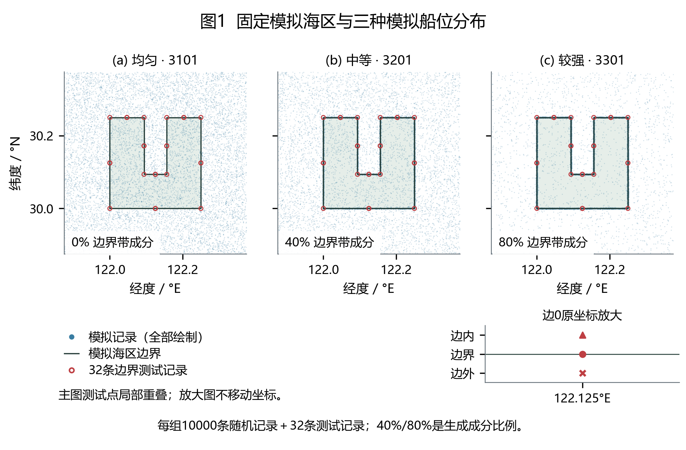
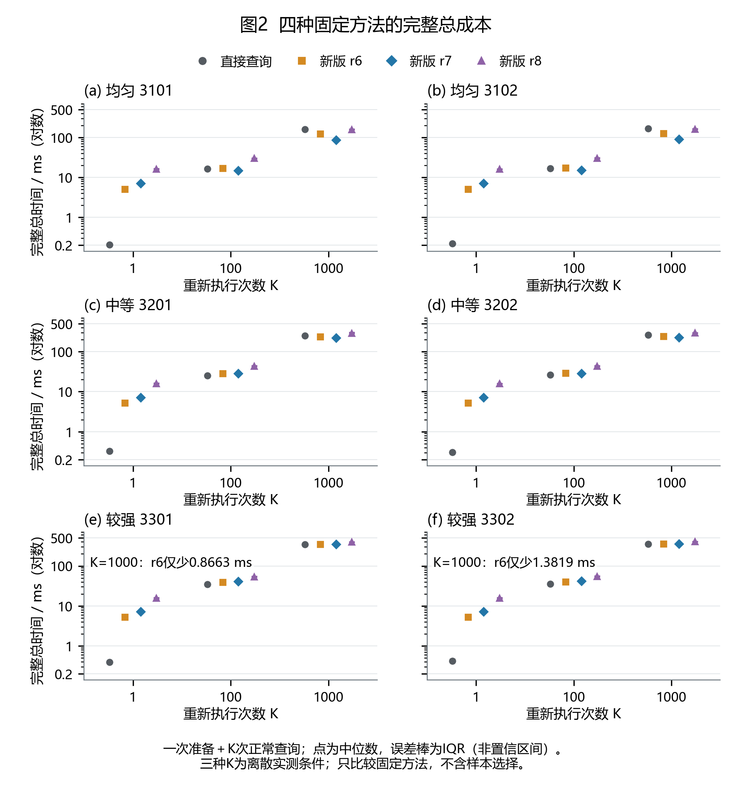
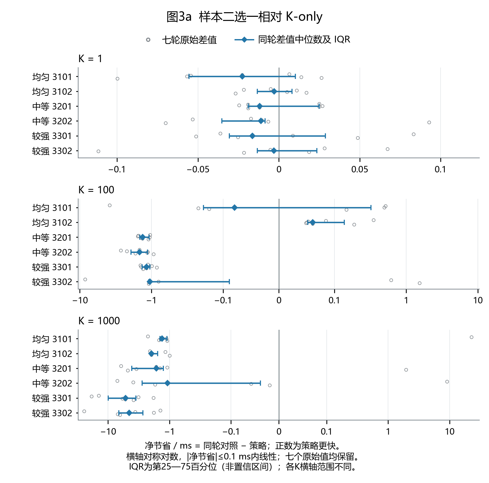
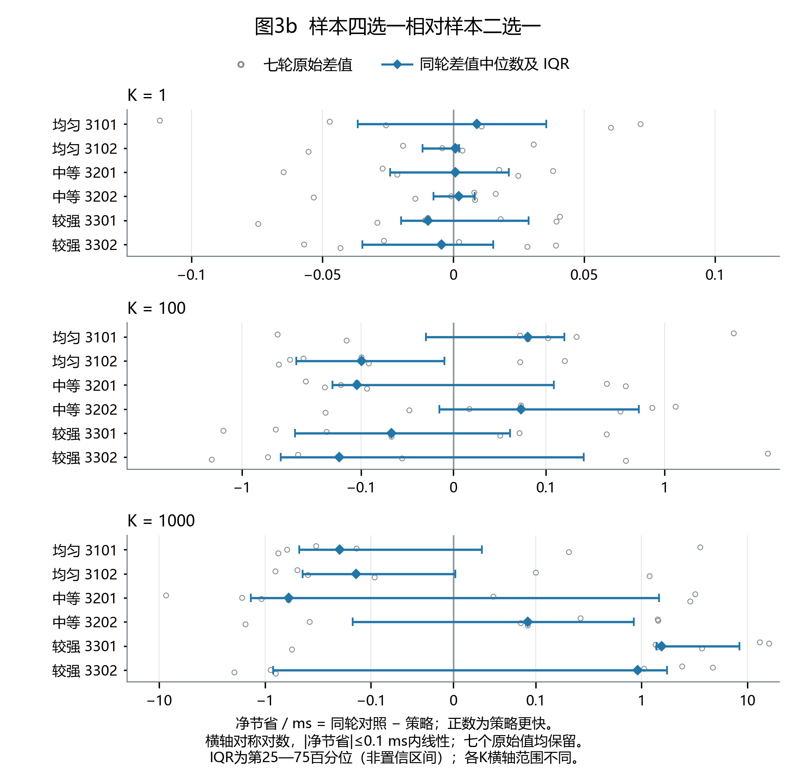
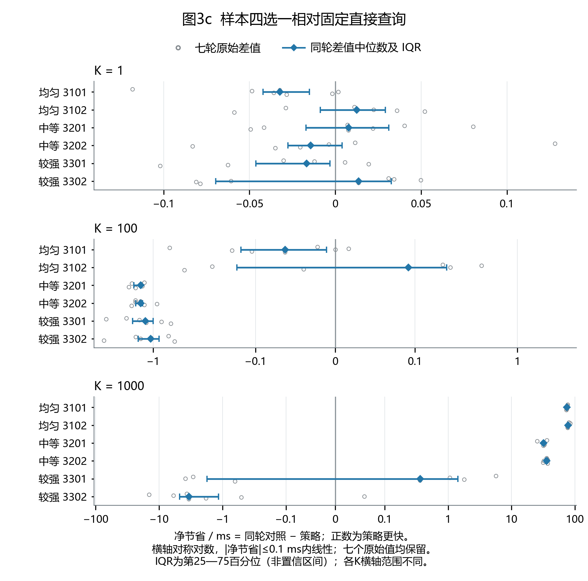
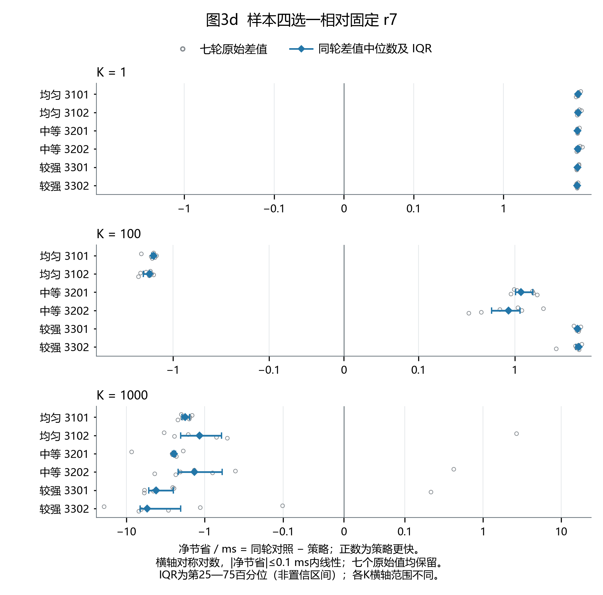
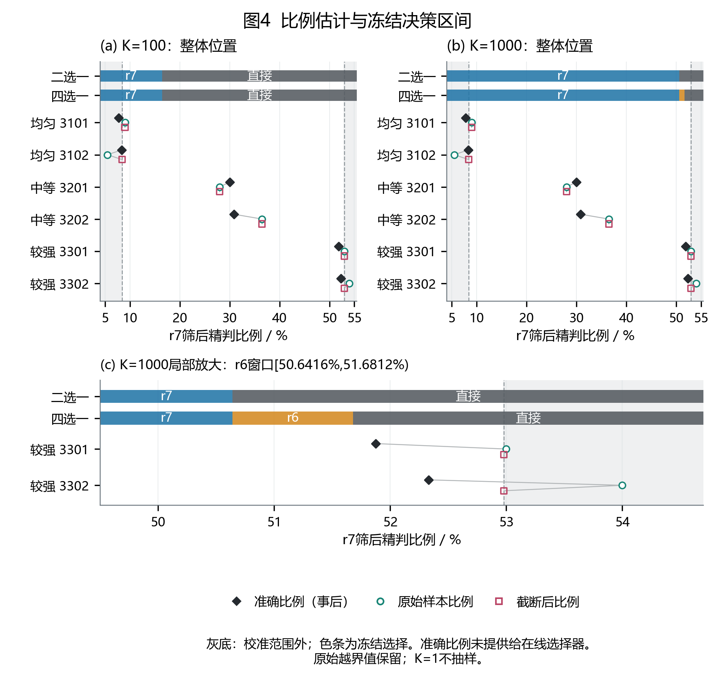

# 固定海区船位查询中 H3 分辨率的成本权衡与轻量选择方法评估

**海洋数据挖掘课程作业 · 完整初稿**

姓名：**待填写**　学号：**待填写**　任课教师：**待填写**  
初稿日期：2026年11月11日　提交日期：**待填写**

**公开 GitHub 仓库链接：待补。尚未发布；经授权发布后填写已核实的真实链接。**  
代码、数据、冻结协议和统计记录的项目内相对位置见附录。本文只整合已经完成的实验，不新增测量或改变模型参数。

## 摘要

H3可通过内部格直接确认、边界格精判减少固定海区查询的几何判断，但更细网格也会增加准备和访问费用，分辨率选择本身同样有成本。本文在一片模拟海区、10032条带唯一ID的模拟船位记录上，比较合理优化的直接查询与r6、r7、r8，并设计固定200点、仅r7编码的轻量特征及简单成本规则。四组旧数据用于校准，六组新数据在K=1、100、1000下独立验证，完整计入准备、选择和正常结果构造。各方法的记录集合完全一致。固定H3在部分场景较快，但样本策略虽在16/18场景选中事后最优固定方法，高于K-only的14/18，仍未取得稳定净收益。按两个总时间中位数之差，K=1000时样本二选一比K-only多花1.3848—3.2943 ms。两样本策略在全部场景选择相同，新增档位未触发。结果表明，在本测试条件下，固定方法的查询节省与轻量选择的实际价值必须分别评价，完整成本比单看精判数量或命中率更能说明方法是否划算。

**关键词：**H3；点在多边形查询；分辨率；准备成本；轻量选择；独立验证

## 1 研究问题与范围

课程提出“格子选多大”以及“编号粗筛、边界点再精判”的问题。本作业从这一具体知识点出发，研究网格粗细怎样影响查询成本，并进一步检验是否值得在查询前增加一次轻量选择。这里的任务是同一片海区内的精确记录查询，不是热点聚合、渔场移动判断或唯一船舶数量估计。

输入包括一个固定模拟海区多边形、一组带唯一记录ID的经纬度点，以及给定的重新执行次数K。对每次查询，输出是符合海区归属条件的记录ID集合；恰好位于边界上的点计入。K次执行均需正常构造结果，各方法应返回完全相同的集合。因此，分辨率变化在本任务中改变的是实现成本，不能改变最终归属答案。

海区和船位全部为模拟数据。每组含10000条随机记录及32条专门边界测试记录，规模固定；记录ID区分的是点记录，不代表不同船舶。本作业只比较当前局部经纬度平面模型下的一片海区、有限分布、三个H3分辨率和同一机器上的实现，不把这些检查当作全球地理情形的正确性证明。

K表示实验要求底层查询重新计算的次数。每个任务支付一次准备费用，随后执行K次查询，任务内复用已准备资产，不缓存最终答案。若现实应用的数据、海区和条件完全不变，保存已有答案可能更合适；本文不建议现实系统重复计算同一结果，而是用这个受控设定研究算法准备成本的摊销。

研究分两层。第一，固定r6、r7、r8相对合理优化的直接查询，在不同分布和K下是否更划算？第二，仅用少量样本估计工作量后再选择方法，能否在支付选择费用后胜过只根据K的简单策略？第二层不能由第一层的加速结果直接推出。

## 2 课程依据与相关技术

### 2.1 课程知识的任务化

课件第5页指出，应根据业务尺度、数据质量和样本量选择分辨率，格子细化会显著增加格子数量；第6页已经给出完整相交格清单、内部格直接纳入、边界格精判的流程；第10页强调已知点验算、总量核对和预先声明换格比较规则[1]。

本文把分辨率问题收窄为固定精确查询的计算成本。课件中的热点统计可能因网格改变而变化；本文保持海区与记录不变，结果集合应当一致。正确性比较使用稳定的记录ID，不对不同分辨率的格子ID直接求交集。边界测试、覆盖审计及逐ID核对落实了课程的检查纪律，但内部格、边界格处理不是本作业首次提出。

### 2.2 既有技术与本文定位

H3默认多边形选格按格子中心是否落入决定，不能直接替代“覆盖全部相交格”的要求；实验接口还提供完全包含、相交以及包围盒相交等模式[2–3]。Shapely的`covers`接受边界，面与点相交同样接受边界；几何预处理和批量坐标谓词是常规优化，运算假定坐标处于同一笛卡尔平面[4]。

Kipf等的正式EDBT研究结合内部真命中、边界精判及S2/四叉树，并利用历史点分布调整网格精度。其主要查询性能针对预建多边形索引，构建时间另报，点编码在实验前完成，实验结果主要计数而非物化逐条ID[5]。Juhász的演示工作直接比较包括H3的多种网格，区分现场编码与预准备，并说明网格近似可能在边缘得到不同点集；本文阅读的是arXiv作者稿，已核实官方演示录用状态，未声称阅读ACM终稿[6]。

这些资料支持过滤与精判、矩形筛选、预处理以及准备成本分离的技术依据，外部工作的规模、语言、任务和结果语义与本文不同，不能直接比较其速度数字。抽样和简单成本估计也不是全新理论。本文的工作是围绕一个限定任务设计具体规则、建立可解释对照，并检验完整收益与局限。

## 3 方法设计

### 3.1 统一的精确查询实现

先创建并预处理海区几何，读取外包矩形，并触发首次谓词初始化，将这些费用归共同几何准备。同一任务后续准备和查询复用该对象；不同任务不共享它。

**直接查询。**从原始坐标出发，先用四个包含等号的矩形条件排除明显不可能点，再对剩余坐标调用向量化`intersects_xy`，返回通过判断的记录ID。矩形覆盖海区边界，精判也包含边界；采用几何预处理并避免逐点创建Point对象，使基线具有合理优化。

**H3查询。**每个分辨率分别从原始经纬度编码，再建立“格子编号→记录位置”的查找关系。海区覆盖清单先通过`bbox_overlap`模式保守枚举，再将H3格轮廓转为当前局部经纬度平面多边形，按`intersects`保留相交格。`covers(海区,格轮廓)`成立的格子归为内部格，其余相交格归为边界格。

不能直接采用默认中心选格：一个格子的中心可能位于海区外，但格子的一部分已进入海区，其中的船位仍可能应当入选。只按中心建立清单会使后续精判连这些点都看不到。本文对当前海区和三档分辨率做覆盖并集与扩大枚举范围审计，检查清单覆盖当前平面海区且没有观察到遗漏；这不是所有球面、极区或跨日期变更线情况的证明。

准备完成后，H3按格取记录：内部格记录直接纳入，边界格候选先提取坐标并进行与直接方法相同的矩形筛选，再精判，最后构造正常返回ID数组。两者边界语义一致，但矩形筛选所在位置不同。格子访问、候选收集、坐标提取、筛选及数组整理费用全部计入，不能只比较精判函数本身。最终固定采用带矩形筛选的r6、r7、r8；未加该筛选的原版仅保留为前期实现对照。

### 3.2 200点、单档r7特征

在线选择阶段只读取原始经纬度、记录数、海区、K及冻结参数，不能读取全量索引、完整覆盖清单、准确边界点数或生成器的分布标签。固定使用种子73001，无放回抽取200条记录，仅进行r7编码。

同一个样本格可能含多个点。构造轮廓、判断格子类别时可去重，以避免重复工作；统计比例时必须通过格子与点的对应关系回到全部200条记录。例如某一边界格有五个样本点，其中四点通过海区矩形筛选，就应贡献四个点，而不是一个格子。

定义原始特征比例为：

`f原始 = 样本中“r7边界格内且位于海区外包矩形内”的记录数 / 200`

分母是全部样本点数。该比例近似反映采用r7时仍需精判的点比例。它可在当前均匀与边界聚集范围内关联到其他方法的工作量，但无法完整描述r6/r8格内位置、分布细节或格子访问数量，因此只是经验近似指标。

200点、只看r7以及候选r6/r7/r8，均是控制课程实验规模和选择费用的工程安排：r7提供统一参照，只编码一档比三档特征提取更轻，r6/r8用于检验相邻粗细档的价值。这些参数未被证明最优。样本编码、局部格轮廓不用于加速后续全量准备，不预扣费用。

### 3.3 预测成本与完整实际成本

对每种方法m，决策使用的简化模型为：

`预计单次查询成本 q_m(f) = a_m + b_m × f`

`预计方法成本 C_m = P_m + K × q_m(f)`

其中P_m为该方法尚需支付的专属准备费用，a_m、b_m为固定海区和规模下的两个查询参数。f按0—1小数代入，图中的百分比仅用于显示。C_m不含各候选共有的共同几何准备，也不再次计入已经执行的选择费用，用于比较“从当前决策点继续运行哪个方法”。

实际评价必须计算全部已经发生的工作：

`固定方法总成本 = 共同几何准备G + 专属准备P_m + 连续K次正常查询`

`选择策略总成本 = 共同几何准备G + 完整选择过程S + 选中方法剩余准备 + 连续K次正常查询`

共同项在候选比较时可以略去，实际计时中仍然存在；抽样后回到直接查询，S也不会消失。本实现不保留可用于全量准备的样本资产，故没有相应扣款。以上公式说明成本组成，结果来自单个外层计时器覆盖完整过程，不是把各分项中位数相加。

### 3.4 旧数据校准与截断

使用旧四组数据，在统一入口下对K=100、1000同轮随机交错补测，各组合七次。每方法每数据组以K=1000连续查询段除以1000后的中位数，形成一个单次成本观测；四组等权最小二乘拟合a_m、b_m。拟合特征是离线准确r7筛后精判比例，每方法只有四个分布观测，重复计时不增加独立观测数。P_m先求各组专属准备中位数，再取四组中位数；共同几何另列。

选择较长连续段作为统一的单次成本校准口径，有助于减小固定开销对每次估计的影响；K=100保留用来检查同一模型能否适用于较短执行长度，不加入拟合或增加参数。准确比例下，旧数据检查最大绝对相对误差约1.36%，这不是在线样本误差或独立验证精度。完整参数和离线费用见附录A。

为限制外推，预测前将比例截断到校准范围：

`f = min(f上限, max(f下限, f原始))`

范围为[0.08433014354066985, 0.529804625199362]。原始值和截断值同时保存，事后准确比例反事实也遵守该规则。K-only不抽样，使用每方法四个单次查询观测的算术平均值，以`P_m + K × 校准单次均值`预测，再仅在直接查询和r7之间选择。

### 3.5 分步决策与五种策略

在直接查询与r7的预测成本相差不超过最低值的2%时，优先直接查询，得到共同基准B。样本二选一采用B；四选一仅在r6或r8预测成本严格小于0.98倍B成本时切换。同价新增方法优先r6，未越过门槛就必须与二选一相同。2%用于避免为很小的预测优势切换，是验证前固定的工程余量，不代表统计显著性，也未被证明最佳。

```text
选择方法(原始坐标, 海区, K, 策略, 冻结参数):
    若 K = 1: 返回 直接查询，不抽样

    若 策略 = K-only:
        计算四方法成本 C[m] = P[m] + K × 校准单次均值[m]
    否则:
        抽取200条记录，只做r7编码及样本格分类
        按样本点计算 f原始，并截断得到 f
        计算四方法成本 C[m] = P[m] + K × (a[m] + b[m] × f)
    记录未作保守处理时的四方法最低者（只供解释）
    若 C[直接] ≤ 1.02 × C[r7]: B = 直接
    否则: B = r7
    若 策略为 K-only 或样本二选一: 返回 B

    新增候选 = r6、r8中满足 C[m] < 0.98 × C[B] 的方法
    若新增候选为空: 返回 B
    否则: 返回其中成本最低者；相同时优先r6
```

数值实现使用1e-12 ms绝对容差处理浮点等式，严格新增门槛的等式点不切换。原始四方法最低者仅为解释记录，不增加正式策略。样本二选一和四选一都单独执行相同抽样、计算全部四方法预测，分别支付费用；不能免费借用彼此结果。五种正式策略为始终直接查询、始终新版r7、K-only、样本二选一、样本四选一，另固定r6/r8作为事后参考。

### 3.6 基于课程的延伸设计

**第一，完整成本口径。**相对课堂查询流程，本文增加了准备摊销与选择费用的显式记账和统一执行入口，解决“准备好以后快”被误当成“完整任务快”的问题。希望在给定K下识别真正净收益，通过优化后的固定方法、K-only和样本策略完整计时检验，而不是仅比较精判点数。

**第二，单档样本特征。**在课堂粗筛、精判基础上，用200点r7筛后边界比例近似描述工作量，再预测多个候选，尝试避免为选择而建立三套全量资产。分类去重而计数按点、输入隔离和参数简化使这项安排可复现；通过准确比例诊断、预测误差和样本策略相对K-only的净收益检验。它是具体工程设计，不是抽样或成本模型的理论首创。

**第三，分离两种增量价值。**以K-only对样本二选一检验“读样本”是否值得，以样本二选一对四选一检验“增加分辨率候选”是否有额外价值。共享B及严格新增门槛确保二/四选一的选择变化确实来自r6/r8；固定四方法提供事后参考。该控制方式的作用是让结果可解释，即使新增档未触发也应如实保留。

## 4 实验设置与评价

### 4.1 海区、记录和两类数据角色

模拟海区位于经度122—122.25、纬度30—30.25的局部范围，北侧有凹口；凹口经度为122.09375—122.15625，向南延伸至纬度30.09375。背景点在经度121.875—122.375、纬度29.875—30.375矩形内均匀生成，既有海区内点也有外点。边界带采用相同平面下距海区边界不超过0.002度的区域，从该矩形均匀提出候选，拒绝不满足距离和内外条件的点，分别补足内外配额。随机部分合并打乱，再加入原32测试记录。

32点由八个顶点、八条边的中点、各边中点内外邻近点各八个组成；邻近偏移约1e-7度。它们检验边界包含及两侧区分，不模拟真实定位噪声。原海区顶点与生成元数据见附录材料索引。

旧四组为均匀A/B（种子20261121、20261122）和80%边界带成分A/B（20261123、20261124），属于探索及校准，不能再作独立验证。新六组严格按预留方案生成：

| 分布 | 新种子 | 背景均匀点 | 边界带内侧 | 边界带外侧 |
| --- | --- | ---: | ---: | ---: |
| 均匀 | 3101、3102 | 10000 | 0 | 0 |
| 中等聚集 | 3201、3202 | 6000 | 2000 | 2000 |
| 较强聚集 | 3301、3302 | 2000 | 4000 | 4000 |

每组再加32点，共10032条。40%/80%是生成成分比例，背景点自身也可能在边界附近。图1仅示意三个种子，后续结果完整保留六组。



**图1**　使用3101、3201、3301的全部已保存坐标，三个主图范围一致。红色标记为32条边界测试记录；主图中局部重叠，放大图只改变观察范围，不移动坐标。海区与船位均为模拟，40%/80%不是实测近边界比例，另三个种子的结果未被省略。

### 4.2 执行方案、冻结顺序与计时范围

新数据均测试K=1、100、1000。五种策略加固定r6/r8共七个执行方案；固定直接与固定r7已经包含在前两种策略中，不重复测一套。共六数据×三K×七方案×七轮=882条正式整体计时，但独立生成的数据仍只有六组。相同抽样种子重复得到相同决策，七轮主要衡量运行波动。

代码、完整精度模型、协议及指纹先封存，再生成预留六组数据，对全部18场景的三种选择策略保存54条推荐，然后才做固定方法及策略的正确性预检、覆盖审计和统一预热。正式任务重新执行选择并支付费用，与保存推荐核对；事后准确比例、真实成本和最快方法不返回选择器。

每轮将126种“数据、K、方案”组合随机交错，各组合七次。一个外层计时器从共同几何准备前开始，到第K次正常返回后结束。单个任务只建立一次共同几何并复用；不同任务重新建立其所需资产，不免费共享点索引、覆盖或选择结果，不缓存最终答案。每次查询正常构造ID结果；读写、数据生成、预热、覆盖审计和任务后的逐ID核对均在正式计时之外，正式测量不额外开启分项诊断。

环境为Windows 11，AMD Ryzen 9 9955HX3D，Python 3.12.14、NumPy 2.3.5、Shapely 2.2.0、GEOS 3.14.1、H3 C/Python 4.5.0，单进程。各方案统一暂停垃圾回收并在结束后恢复。旧探索、矩形对照、校准与独立验证分别保留，不跨运行时段相减绝对耗时。

### 4.3 评价指标与两种净节省口径

**完整总时间**是上述一次准备加K次查询的整体耗时；每场景每方案报告七次总时间的中位数和第25—75百分位区间。**IQR**描述中间一半重复值的范围，本文采用线性插值分位数；它不是置信区间，也不覆盖最坏损失。

净节省始终采用“对照减策略”，正数表示策略更快。两种汇总方式分别定义：

`净节省（中位数差） = 对照七次总时间的中位数 − 策略七次总时间的中位数`

其百分比以对照总时间中位数为分母。**摘要、主要数值总结和附录主表采用这一口径。**

`每轮净节省 = 该轮对照总时间 − 该轮策略总时间`

`净节省（同轮差中位数） = 七个每轮净节省的中位数`

**图3a—3d采用同轮差中位数、其IQR及全部七轮原始值**，同轮是同一随机交错轮次而不是同时执行。同轮百分比以该轮对照时间为分母。中位数不是线性运算，两种量可能不同，微小结果甚至可能异号；引用时明确说明，不互相替换。最坏同轮损失取每轮“策略减对照”的最大值，并同时保留该轮百分比，不能将不同轮次的最大毫秒与最大百分比拼在一起。

**事后最优固定方法**取四固定方法各自总时间中位数中的最低者，不取原始记录中偶然最快的一次；它仅作参考，不是可免费获得的线上策略。**方法命中**指选择的方法名称与该参考一致，不包括选择费用，也不按选对或选错的时间差加权。18场景不能当作18批独立数据，命中数只作描述，不解释成泛化概率或统计显著性。

## 5 结果与分析

### 5.1 正确性与固定方法成本

四种固定方法和三种选择策略均与直接精确几何参照逐条核对记录ID；882条正式记录的误选、漏选、重复均为0，32测试点与覆盖审计通过，正式重做的选择与预先推荐一致。以下讨论是在当前局部平面模型下得到同一答案的成本，而非以近似结果换速度。

图2表明，细分辨率不必然具有较低完整成本。K=1时直接查询在六组固定方法中均有最低中位数，H3编码、索引和覆盖费用尚难摊销。K=1000时均匀与中等聚集的固定r7最低，例如均匀3101中直接查询与r7总时间中位数分别为161.0504、85.1269 ms。较强聚集两组则是r6略低于r7，差额0.8663、1.3819 ms，约0.25%、0.39%；这是观察到的中位数差，不凭七次计时宣称显著优势。



**图2**　六组、三个离散K与四固定方法的完整总时间；标记为七次中位数，误差棒为IQR。全部费用含一次共同及专属准备、K次查询和结果构造，不含样本选择。各子图使用相同对数纵轴，不拟合连续性能曲线；IQR不是置信区间，微小差额不代表显著优势。

### 5.2 为什么命中更多仍未稳定省时

样本二选一和四选一均在16/18场景命中事后最优固定方法，K-only为14/18。多出的两次命中都在均匀数据K=100：按两个固定方法中位数之差，r7相对直接查询的收益空间仅1.5681、1.8691 ms。样本二选一相对所选固定r7的总时间中位数差却为1.7543、1.7460 ms。后者包含选择流程、执行上下文与波动，不能全部称为抽样费，但足以说明小收益为何容易被抵消，命中次数也未给大收益更高权重。

按主要总结采用的**中位数差口径**，样本二选一相对K-only在这两场景的净节省分别为−0.1855、+0.0910 ms；K=100的另外四组均负，K=1000六组全部负，损失1.3848—3.2943 ms。因而本轮没有显示抽样相对K-only具有稳定净收益。

图3a使用的是**同轮差中位数口径**。上述均匀K=100两场景分别为−0.0794、+0.0609 ms，后者虽七轮均正，幅度仍很小。K=1000的六组同轮差中位数也均负。最坏一轮发生在较强聚集3302、K=1000，样本二选一相对K-only多花24.4056 ms（该轮6.9551%）；该场景的同轮净节省中位数为−4.5294 ms，不能以−3.2943 ms的两个中位数差替代图上数值。



**图3a**　样本二选一相对K-only。每个K面板保留六组数据及七轮原始差值；净节省为同轮对照减策略，菱形和误差棒为差值中位数及IQR，空心点为七轮原值。横轴为标注阈值的对称对数，零附近线性；IQR不代表最坏损失，也不是置信区间。K=1均不抽样。

### 5.3 增加候选是否产生额外价值

二选一与四选一在全部18场景采用相同方法，即使计时有微小正负差，也没有新增方法变化可供归因（图3b）。**本验证集未触发新增档位，未验证其被选中后的收益。**它限制了当前可得结论，不能推广为其他分辨率无价值。相同种子下七次重复不是更多独立抽样，也不能用微小差异人为证明四选一更好。



**图3b**　样本四选一相对样本二选一。范围、七轮原始点、差值中位数、IQR与横轴定义同图3a。两者全部场景选择相同；图上正负差值包含独立执行的流程与计时波动，不能归为新增分辨率收益。

### 5.4 相对固定对照的收益与统计量异号

按**中位数差口径**，四选一相对固定直接查询在K=1000均匀两组净省74.1263、77.4311 ms（46.03%、46.30%），中等聚集省32.2304、34.4999 ms（12.74%、13.24%）；较强聚集则为−1.8359、−2.0852 ms。K=100六组该口径均未得到净收益。相对固定r7，K=1均省约6.65—6.81 ms，K=100中等及较强聚集省0.8046—4.4307 ms，而K=100均匀两组及K=1000六组均为负。固定H3有时较快与样本选择值得付费是不同结论，不能只挑一个固定对照说明策略有效。

图3c展示**同轮差中位数**：K=1000均匀两组为74.7096、77.4311 ms，中等聚集为31.8905、35.8269 ms。较强聚集3301为小幅正值+0.3621 ms，IQR为−1.76495至+1.43485 ms。这与前段的−1.8359 ms不同：前者先逐轮相减再求中位数，后者分别求总时间中位数再相减，不应强行整理成一致方向。该场景四选一也执行直接查询，微小异号不证明方法变化或稳定收益。



**图3c**　样本四选一相对固定直接查询，统计与尺度定义同图3a，全部场景和原始波动保留。较强聚集3301、K=1000的同轮差中位数为+0.3621 ms；正文主要总结中的两个中位数差为−1.8359 ms，二者不是同一个统计量。

图3d按**同轮差中位数口径**显示，四选一相对固定r7在K=1000六组均为负；K=1通过直接查询避免了H3准备。连同前述结果，这说明选择策略的价值取决于对照，不能从“比固定直接快”跳到“比简单选择更划算”。



**图3d**　样本四选一相对固定r7。定义同图3a，七轮原值不剔除；正值为四选一更快。原12面板总览版保留于附录链接，正文分图只改变阅读布局，不改变统计与场景。

### 5.5 抽样误差、保守规则与实际成本

图4说明，估计误差存在，但本轮没有因此改变推荐。中等聚集3202的准确比例约30.85%，样本为36.50%，偏高5.65个百分点；对应K=1000的r7固定方法成本预测误差由准确比例下−1.18%变成样本下+13.80%。事后将准确比例代入冻结规则、仍按校准范围截断后，样本策略推荐均未变化，不能把损失主要归因于抽样选错。未改选也不等于样本估计准确。

较强聚集两组准确比例约51.87%、52.33%，高于r6最终窗口上界约51.68%。准确比例下原始模型最低成本方法是r6，但加入冻结保守规则后仍选直接查询，实际固定中位数也只是r6略快。原始模型排序、保守决策与完整总成本是三个不同环节；2%是工程取舍而非显著性门槛。



**图4**　六组的事后准确比例、固定200点原始样本比例及截断比例，与K=100、1000冻结决策区间。范围外原值保留，色条表示最终选择，局部放大保留r6窗口与较强聚集点的位置。准确比例不曾提供给在线选择器，其反事实仍按冻结范围截断；K=1无样本，不补造比例。符号与颜色说明在图内。

校准阶段独立测得的正常选择费用约0.8843—1.4629 ms，仅提供当时量级参照，不能直接加到最终固定方法中位数上。最终策略减所选固定方法的差额还含执行上下文与波动，与独立测量的S不是同一个量。以上诊断共同说明本轮成本来源，但不构成精确、互斥的因果分解。

### 5.6 单独的查询实现因素对照

前期矩形筛选单因素实验中，边界A/r7的8198个边界候选有2965个被矩形排除，剩5233个精判；同轮一次准备加1000次查询的总时间中位数减少81.4720 ms。并非所有组合都改善，例如该轮均匀A/r8的中位数差为−0.2303 ms。这支持先固定实现再比较分辨率，但不能把精判减少直接等同整体更快。该实验是独立阶段，只比较其同轮原版与新版，不拿它与最终验证的绝对时间跨运行相减。

## 6 局限与后续设想

本文只覆盖一片模拟海区、固定记录规模及有限分布。0.002度是局部平面距离，不是全球固定米数；H3球面网格轮廓与平面谓词组合在当前数据中通过检查，不证明所有纬度、日期变更线、复杂洞或海岸细节均正确。数据没有真实AIS的清洗、定位误差、重复报文、时间窗、船舶身份及动态更新问题，不能把记录查询结果解释成真实渔场或唯一船数。

六组独立数据不足以给出普遍成功率。每组只用一个固定抽样种子，七次计时观察耗时波动而非抽样分布；IQR与工程余量均不是显著性检验。模型每方法只用四组旧数据拟合两个参数，单一r7指标和截断限制了外推。未触发新增档意味着尚未检验其被选中后的净收益，而不是其他分辨率普遍无用。

未来可考虑两项具体改进，但本次不实施：其一，减少局部轮廓构造、数组整理等选择步骤的成本；若复用已完成资产，需重新明确哪些准备真正可以扣减。其二，在支付样本费用前估计可获得收益的保守上限，若小于选择费用则跳过抽样。两者都需先冻结新规则，再用其他独立材料检验；不能把本批验证数据用于调参后仍称其独立验证。

## 7 结论

在本固定海区、规模、分布及实现下，H3在一些K和点分布条件中可以用较少精判换取完整成本下降，但分辨率细化并不保证更快，准备与访问费用不能忽略。当前200点单档特征策略提高了事后固定方法命中数，却没有稳定胜过K-only；小幅方法收益容易被选择流程抵消，保守规则也会放弃部分预测优势。

本作业的课程延伸在于将这些费用放入同一可复核口径，设计低成本近似特征，并用共享基准对照区分抽样价值与新增候选价值。结果支持这些具体设计的局部评估，不支持“H3普遍更快”或“抽样选择普遍无效”。本验证集未触发新增档位，未验证其被选中后的收益，完整记录应连同正负结果一起保留。

## 参考文献

[1] 海洋数据挖掘课程课件：《第3讲·课时2：渔场真的“东移”了吗？（修订版）》，第5、6、10页。授课教师与课件年份待按课程信息填写。[项目内转换课件](../../PPT_Markdown/第3讲_课时2_渔场真的东移了吗_修订版/第3讲_课时2_渔场真的东移了吗_修订版.md)。

[2] H3 maintainers / Uber. **Region functions**. H3 4.x官方文档，访问日期2026-11-11。[官方链接](https://h3geo.org/docs/api/regions/)。

[3] h3-py contributors. **API Verbose Reference**，`h3shape_to_cells_experimental`。在线4.x文档；实验锁定H3 C/Python 4.5.0，访问日期2026-11-11。[官方链接](https://uber.github.io/h3-py/api_verbose.html#h3.h3shape_to_cells_experimental)。

[4] Sean Gillies and Shapely contributors. **The Shapely User Manual**, 2.2.0, 2026-10-07；**shapely.covers**, 2.2.0。[手册](https://shapely.readthedocs.io/en/2.2.0/manual.html)、[covers](https://shapely.readthedocs.io/en/2.2.0/reference/shapely.covers.html)。另核对2.1.2版[intersects_xy](https://shapely.readthedocs.io/en/2.1.2/reference/shapely.intersects_xy.html)、[prepare](https://shapely.readthedocs.io/en/2.1.2/reference/shapely.prepare.html)接口说明，访问日期2026-11-11；本机运行版为2.2.0，不将未读单页冒充同版资料。

[5] Andreas Kipf, Harald Lang, Varun Pandey, Raul Alexandru Persa, Christoph Anneser, Eleni Tzirita Zacharatou, Harish Doraiswamy, Peter Boncz, Thomas Neumann, Alfons Kemper. **Adaptive Main-Memory Indexing for High-Performance Point-Polygon Joins**. EDBT, 2020: 347–358. DOI: [10.5441/002/edbt.2020.31](https://doi.org/10.5441/002/edbt.2020.31)。正式会议研究论文。[正式全文](https://openproceedings.org/2020/conf/edbt/paper_190.pdf)、[CWI书目](https://ir.cwi.nl/pub/29605)。本文使用其摘要、引言、§3.3.1、§3.4和§4的相关方法及成本口径，不声称复现其结果。

[6] Levente Juhász. **Accelerating Point-in-Polygon Predicates via Algebraic Hash-Joins and Discrete Global Grids at Scale: An Interactive Benchmark**. arXiv:2607.08956v2, 2026-08-24，作者稿。[版本页](https://arxiv.org/abs/2607.08956)、[所读全文](https://arxiv.org/html/2607.08956v2)。[SIGSPATIAL 2026官方程序](https://sigspatial2026.sigspatial.org/detailed-program.html)列为Demo D-661；相关DOI：[10.1145/3841645.3843101](https://doi.org/10.1145/3841645.3843101)。核查为演示录用，实际阅读作者稿§2—3，未核读ACM终稿或编造终稿页码，不称正式长研究论文。

<!-- APPENDICES_FROM_SAVED_RECORDS -->

## 附录 A　冻结校准参数与决策规则

附录数值读取既有CSV/JSON，没有重新测量或拟合。下列文件链接均相对于本报告所在目录。

### A.1 完整精度模型参数

方法预测成本为“专属准备成本 P + K × (a + b × f_used)”。a为每次查询的截距成本，b为比例每增加1对应的每次查询成本；f_used采用0—1小数。下表保留JSON数值的完整可往返浮点文本，单位为ms，b的单位为ms/次/单位比例。最后一列是K-only使用的旧四组单次查询成本观测平均值。

| 方法 | P：prepare_ms | a：a_ms | b：b_ms | K-only均值：mean_query_ms |
| --- | ---: | ---: | ---: | ---: |
| 直接查询 | 0.0023 | 0.12959138841130025 | 0.42682777208191247 | 0.2598798 |
| r6 | 4.81345 | 0.07935609639347324 | 0.5011691329514824 | 0.232337075 |
| r7 | 6.68405 | 0.03136069274735548 | 0.5942191594933562 | 0.212745025 |
| r8 | 15.30545 | 0.09716852704556013 | 0.5482254106878738 | 0.26451335 |

共同几何预测值G为 `0.033875` ms，实际完整任务仍真正执行并计费；候选相对比较中略去相同项，不代表免费。校准范围 f_min=`0.08433014354066985`、f_max=`0.529804625199362`。样本量=`200`，样本种子=`73001`。

来源：[完整精度模型](../runs/selector_cal_20261111_140827_086716/online_model.json)，其`methods`与上述同名字段一一对应；[离线训练观测](../runs/selector_cal_20261111_140827_086716/offline_training_cases.csv)记录每旧数据组的`query_ms,prepare_ms,f_exact`。四组等权最小二乘仅使用K=1000的正常查询段观测；K=100只检查。

### A.2 冻结规则及最终选择区间

K=1按既定捷径直接查询、不抽样。其他K：先确定共同基准B，direct预测成本≤1.02×r7时B=direct，否则B=r7。样本二选一采用B；四选一仅在r6或r8预测成本严格小于0.98×B成本时切换到符合者中最低者，新增候选同价优先r6。不越过门槛则二、四选一必须相同。原始四方法最低成本仅作解释记录，不增加计时策略。浮点等式容差为1e-12 ms，只处理舍入，不替代2%工程余量。

下表采用截断后比例f_used，在校准范围内合并最终选择相同的相邻区间。区间端点遵循已保存`kind=boundary`记录，不重新求交点。

| K | f_used范围 | 样本二选一 | 样本四选一 |
| ---: | --- | --- | --- |
| 100 | [0.08433014354066985, 0.1642674395442387) | r7 | r7 |
| 100 | [0.1642674395442387, 0.529804625199362] | 直接 | 直接 |
| 1000 | [0.08433014354066985, 0.5064156216118021) | r7 | r7 |
| 1000 | [0.5064156216118021, 0.516811596574955) | 直接 | r6 |
| 1000 | [0.516811596574955, 0.529804625199362] | 直接 | 直接 |

原始比例低于/高于校准范围时，先截到f_min/f_max，再用上述规则。r8在本模型的校准区间及截断尾部没有最终入选区间；在所分析的K=100、1000中，r6的入选窗口只在K=1000上述窄区间存在。这是冻结模型与工程规则的性质，不是验证后对各分辨率普遍价值的判断。

不保守时的四方法原始最低者另有以下转折：K=100在f=0.18766315370056594处从r7转为direct（等式点direct）；K=1000在f=0.4956989843023951之后从r7转为r6（等式点r7）。全部28条区间/边界/截断尾部记录见[CSV](../runs/selector_cal_20261111_140827_086716/decision_intervals.csv)和[JSON](../runs/selector_cal_20261111_140827_086716/decision_intervals.json)，冻结实现见[规则代码](../selector_decision.py)。

## 附录 B　全部18场景的完整总时间中位数

单位ms；每格是七次完整任务总时间的中位数，不是单次查询时间。D表示直接查询，6/7/8表示新版H3相应分辨率；KO为K-only，S2/S4为样本二/四选一。策略列括号内给出实际选中方法。固定方案不含选择，策略方案含真实选择费用；共同几何及剩余准备、K次正常查询与结果构造均在实际任务计时内。

| 数据 | K | 固定D | 固定6 | 固定7 | 固定8 | KO（选择） | S2（选择） | S4（选择） |
| --- | ---: | ---: | ---: | ---: | ---: | ---: | ---: | ---: |
| 均匀3101 | 1 | 0.2075 | 5.0398 | 7.0275 | 16.0695 | 0.2255(D) | 0.2220(D) | 0.2403(D) |
| 均匀3101 | 100 | 16.2216 | 16.7956 | 14.6535 | 29.6472 | 16.2223(D) | 16.4078(7) | 16.2418(7) |
| 均匀3101 | 1000 | 161.0504 | 122.5553 | 85.1269 | 156.5780 | 85.3420(7) | 86.7268(7) | 86.9241(7) |
| 均匀3102 | 1 | 0.2202 | 5.0565 | 7.0185 | 15.9504 | 0.2076(D) | 0.2125(D) | 0.2078(D) |
| 均匀3102 | 100 | 16.7429 | 17.0702 | 14.8738 | 30.2610 | 16.7108(D) | 16.6198(7) | 16.9423(7) |
| 均匀3102 | 1000 | 167.2532 | 125.7622 | 88.5523 | 159.9756 | 87.8703(7) | 89.6832(7) | 89.8221(7) |
| 中等3201 | 1 | 0.3221 | 5.1294 | 7.0114 | 15.7677 | 0.3079(D) | 0.3111(D) | 0.3119(D) |
| 中等3201 | 100 | 25.3619 | 27.9132 | 28.0371 | 43.1278 | 25.6028(D) | 26.8663(D) | 26.8634(D) |
| 中等3201 | 1000 | 252.9845 | 233.8375 | 218.2712 | 289.8808 | 219.3043(7) | 220.8027(7) | 220.7541(7) |
| 中等3202 | 1 | 0.3048 | 5.1320 | 7.0610 | 15.7293 | 0.3036(D) | 0.3326(D) | 0.3246(D) |
| 中等3202 | 100 | 26.2694 | 28.7346 | 28.4556 | 43.3756 | 26.3575(D) | 28.0772(D) | 27.6510(D) |
| 中等3202 | 1000 | 260.5709 | 242.5352 | 224.0442 | 293.8017 | 224.8624(7) | 226.2676(7) | 226.0710(7) |
| 较强3301 | 1 | 0.3941 | 5.2335 | 7.0721 | 15.4128 | 0.3943(D) | 0.4106(D) | 0.4184(D) |
| 较强3301 | 100 | 35.0310 | 38.9607 | 40.7354 | 53.3518 | 35.1403(D) | 36.2921(D) | 36.3047(D) |
| 较强3301 | 1000 | 348.7875 | 346.5219 | 347.3882 | 394.8909 | 349.2230(7) | 352.1685(D) | 350.6234(D) |
| 较强3302 | 1 | 0.4150 | 5.1935 | 7.0972 | 15.5338 | 0.4032(D) | 0.4113(D) | 0.4346(D) |
| 较强3302 | 100 | 35.3656 | 39.4968 | 41.0457 | 53.8405 | 35.4627(D) | 36.4161(D) | 36.7456(D) |
| 较强3302 | 1000 | 352.6519 | 349.8512 | 351.2331 | 401.4608 | 350.9032(7) | 354.1975(D) | 354.7371(D) |

来源：[summary.csv](../runs/validation_20261111_151150_257869/summary.csv)，筛选`dataset,K,scheme`，字段`median_ms,chosen_method`；IQR、min/max等详细统计仍在同文件，原始882条在[formal_trials.csv](../runs/validation_20261111_151150_257869/formal_trials.csv)的`total_ns`（除以1000000转ms）。每个“数据×K×方案”有七条，不代表七组独立数据。

## 附录 C　全部18场景净节省：两个总时间中位数之差

本表是摘要和主要数值总结使用的中位数差口径：“对照总时间中位数−策略总时间中位数”，正数为策略更快。括号为该差除以对照总时间中位数后的百分比。它不一定等于图3的同轮差值中位数。负值全部保留，表格显示四位小数ms、两位小数%，详细精度见原CSV。

| 数据 | K | S2相对KO：ms（%） | S4相对S2：ms（%） | S4相对固定D：ms（%） | S4相对固定7：ms（%） |
| --- | ---: | ---: | ---: | ---: | ---: |
| 均匀3101 | 1 | +0.0035（+1.55%） | −0.0183（−8.24%） | −0.0328（−15.81%） | +6.7872（+96.58%） |
| 均匀3101 | 100 | −0.1855（−1.14%） | +0.1660（+1.01%） | −0.0202（−0.12%） | −1.5883（−10.84%） |
| 均匀3101 | 1000 | −1.3848（−1.62%） | −0.1973（−0.23%） | +74.1263（+46.03%） | −1.7972（−2.11%） |
| 均匀3102 | 1 | −0.0049（−2.36%） | +0.0047（+2.21%） | +0.0124（+5.63%） | +6.8107（+97.04%） |
| 均匀3102 | 100 | +0.0910（+0.54%） | −0.3225（−1.94%） | −0.1994（−1.19%） | −2.0685（−13.91%） |
| 均匀3102 | 1000 | −1.8129（−2.06%） | −0.1389（−0.15%） | +77.4311（+46.30%） | −1.2698（−1.43%） |
| 中等3201 | 1 | −0.0032（−1.04%） | −0.0008（−0.26%） | +0.0102（+3.17%） | +6.6995（+95.55%） |
| 中等3201 | 100 | −1.2635（−4.94%） | +0.0029（+0.01%） | −1.5015（−5.92%） | +1.1737（+4.19%） |
| 中等3201 | 1000 | −1.4984（−0.68%） | +0.0486（+0.02%） | +32.2304（+12.74%） | −2.4829（−1.14%） |
| 中等3202 | 1 | −0.0290（−9.55%） | +0.0080（+2.41%） | −0.0198（−6.50%） | +6.7364（+95.40%） |
| 中等3202 | 100 | −1.7197（−6.52%） | +0.4262（+1.52%） | −1.3816（−5.26%） | +0.8046（+2.83%） |
| 中等3202 | 1000 | −1.4052（−0.62%） | +0.1966（+0.09%） | +34.4999（+13.24%） | −2.0268（−0.90%） |
| 较强3301 | 1 | −0.0163（−4.13%） | −0.0078（−1.90%） | −0.0243（−6.17%） | +6.6537（+94.08%） |
| 较强3301 | 100 | −1.1518（−3.28%） | −0.0126（−0.03%） | −1.2737（−3.64%） | +4.4307（+10.88%） |
| 较强3301 | 1000 | −2.9455（−0.84%） | +1.5451（+0.44%） | −1.8359（−0.53%） | −3.2352（−0.93%） |
| 较强3302 | 1 | −0.0081（−2.01%） | −0.0233（−5.66%） | −0.0196（−4.72%） | +6.6626（+93.88%） |
| 较强3302 | 100 | −0.9534（−2.69%） | −0.3295（−0.90%） | −1.3800（−3.90%） | +4.3001（+10.48%） |
| 较强3302 | 1000 | −3.2943（−0.94%） | −0.5396（−0.15%） | −2.0852（−0.59%） | −3.5040（−1.00%） |

来源：[comparisons.csv](../runs/validation_20261111_151150_257869/comparisons.csv)的`median_difference_saving_ms,median_difference_saving_percent`，按`dataset,K,strategy,control`筛选。不能将这里的数字直接当作图3上的菱形。

## 附录 D　全部18场景的同轮差值中位数与IQR

本表是图3使用的同轮差中位数口径：每一轮先求“对照总时间−策略总时间”，再对七个差值求中位数、第25/75百分位。每格为中位数[Q25,Q75]，单位ms；IQR不是置信区间，也不是最坏损失。全部504个原始配对差保留在CSV。

| 数据 | K | S2相对KO | S4相对S2 | S4相对固定D | S4相对固定7 |
| --- | ---: | ---: | ---: | ---: | ---: |
| 均匀3101 | 1 | −0.0226 [−0.0555, +0.0102] | +0.0089 [−0.0364, +0.0355] | −0.0323 [−0.0421, −0.0150] | +6.8163 [+6.7089, +6.8496] |
| 均匀3101 | 100 | −0.0794 [−0.1888, +0.3216] | +0.0807 [−0.0299, +0.1434] | −0.0630 [−0.1391, −0.0110] | −1.5853 [−1.6605, −1.5575] |
| 均匀3101 | 1000 | −1.3271 [−1.4331, −1.1033] | −0.1973 [−0.4741, +0.0348] | +74.7096 [+73.9981, +75.1631] | −1.7861 [−1.9585, −1.5641] |
| 均匀3102 | 1 | −0.0029 [−0.0133, +0.0081] | +0.0007 [−0.0117, +0.0023] | +0.0124 [−0.0088, +0.0292] | +6.8167 [+6.6966, +6.9672] |
| 均匀3102 | 100 | +0.0609 [+0.0519, +0.1363] | −0.0994 [−0.3500, −0.0095] | +0.0919 [−0.1523, +0.2047] | −1.7600 [−2.0349, −1.6898] |
| 均匀3102 | 1000 | −1.9659 [−1.9908, −1.5533] | −0.1389 [−0.4439, +0.0024] | +77.4311 [+76.7839, +79.0127] | −1.1711 [−2.0301, −0.6104] |
| 中等3201 | 1 | −0.0119 [−0.0190, +0.0250] | +0.0008 [−0.0242, +0.0212] | +0.0077 [−0.0171, +0.0312] | +6.7234 [+6.6978, +6.7355] |
| 中等3201 | 100 | −1.3314 [−1.4583, −1.0779] | −0.1079 [−0.1741, +0.1170] | −1.3235 [−1.5488, −1.2963] | +1.1606 [+1.0207, +1.5434] |
| 中等3201 | 1000 | −1.6446 [−4.1075, −1.2550] | −0.5990 [−1.3634, +1.4652] | +31.8905 [+31.6910, +32.6831] | −2.4829 [−2.5969, −2.3690] |
| 中等3202 | 1 | −0.0111 [−0.0352, −0.0085] | +0.0020 [−0.0077, +0.0082] | −0.0143 [−0.0277, +0.0039] | +6.7535 [+6.6556, +7.0529] |
| 中等3202 | 100 | −1.4670 [−1.9351, −1.1324] | +0.0732 [−0.0151, +0.6086] | −1.3255 [−1.4861, −1.2704] | +0.8638 [+0.5747, +1.1324] |
| 中等3202 | 1000 | −1.0819 [−2.7975, −0.0384] | +0.0904 [−0.1485, +0.8436] | +35.8269 [+34.0035, +36.7208] | −1.3601 [−2.1980, −0.5998] |
| 较强3301 | 1 | −0.0163 [−0.0307, +0.0288] | −0.0097 [−0.0199, +0.0287] | −0.0168 [−0.0463, −0.0032] | +6.6796 [+6.5751, +6.8842] |
| 较强3301 | 100 | −1.1699 [−1.3479, −1.0534] | −0.0669 [−0.3581, +0.0612] | −1.1894 [−1.5919, −0.9989] | +4.4786 [+4.4224, +4.6373] |
| 较强3301 | 1000 | −5.2179 [−9.9688, −3.5149] | +1.5451 [+1.3865, +8.4141] | +0.3621 [−1.7650, +1.4348] | −4.1994 [−5.2011, −2.5175] |
| 较强3302 | 1 | −0.0031 [−0.0133, +0.0235] | −0.0046 [−0.0348, +0.0152] | +0.0136 [−0.0697, +0.0327] | +6.6339 [+6.5410, +6.6898] |
| 较强3302 | 100 | −1.0543 [−1.0850, −0.0888] | −0.1522 [−0.4728, +0.2092] | −1.0589 [−1.4010, −0.8768] | +4.6096 [+4.3331, +4.6775] |
| 较强3302 | 1000 | −4.5294 [−6.6658, −2.7004] | +0.9138 [−0.8390, +1.7381] | −3.3887 [−4.7681, −1.1587] | −5.4515 [−6.7023, −2.0235] |

来源：[paired_differences.csv](../runs/validation_20261111_151150_257869/paired_differences.csv)的`net_saving_ms,trial`，线性插值分位数；与`comparisons.csv/paired_median_saving_ms,paired_q25_saving_ms,paired_q75_saving_ms`逐组一致。同轮指同一随机交错轮次，不是两项同时运行。

### D.1 方向不同的微小结果：较强3301、K=1000

四选一相对直接查询，两总时间中位数之差为−1.8359 ms（−0.526366%），表示按中位数差口径策略更慢；同轮差值中位数则为+0.3621 ms，IQR=[−1.76495,+1.43485] ms，按同轮差中位数口径略为正。七轮差值按trial顺序是`[+5.7000, −2.8964, +1.0680, −3.8268, +1.8017, +0.3621, −0.6335]` ms。两种量先聚合与先相减的顺序不同，出现这种方向差异不矛盾；不能把“较强聚集两组都慢”的中位数差口径陈述直接搬到图3的同轮差中位数口径。两方案此处均执行direct，也不能据小幅正值解释成选择质量收益。

### D.2 最坏损失与另一统计量：较强3302、K=1000

样本二选一相对K-only的两个中位数之差为−3.2943 ms（−0.938806%）；同轮差值中位数为−4.5294 ms，IQR=[−6.66585,−2.70035] ms。最坏同轮是trial=2，多花24.4056 ms，该轮6.955080%。最坏毫秒损失与全局最坏百分比未必来自同一轮，不可拼接。

同一场景四选一相对二选一的两个中位数之差为−0.5396 ms，但同轮差值中位数为+0.9138 ms，IQR=[−0.839, +1.73815] ms。两者实际选择相同方法，故这些细小差异不代表增加分辨率候选的收益。

## 附录 E　原始材料与字段索引

- 最终验证协议与时序：[protocol.json](../runs/validation_20261111_151150_257869/protocol.json)、[events.jsonl](../runs/validation_20261111_151150_257869/events.jsonl)。先冻结，生成六组，保存54推荐，再预检预热和正式计时；没有利用事后最优回填选择。
- 正确性：[correctness.json](../runs/validation_20261111_151150_257869/correctness.json)的逐方法ID、`boundary_probes_passed,coverage.passed`，以及正式原始记录的误选/漏选/重复字段。
- 推荐与真实重做：[prerecommendations.jsonl](../runs/validation_20261111_151150_257869/prerecommendations.jsonl)、[formal_choice_traces.jsonl](../runs/validation_20261111_151150_257869/formal_choice_traces.jsonl)。样本位置、分子、原始/截断比例、成本、B及新增门槛均保存。
- 命中与流程差：[strategy_regret.csv](../runs/validation_20261111_151150_257869/strategy_regret.csv)的`exact_best_method_match,chosen_fixed_penalty_ms,policy_minus_same_fixed_ms`；事后最优来自[posthoc_oracle.csv](../runs/validation_20261111_151150_257869/posthoc_oracle.csv)。后者取四固定方法总时间中位数最低者，不挑原始最快单次。
- 比例与事后反事实：[sample_feature_errors.csv](../runs/validation_20261111_151150_257869/sample_feature_errors.csv)、[posthoc_diagnostics.csv](../runs/validation_20261111_151150_257869/posthoc_diagnostics.csv)、[fixed_prediction_errors.csv](../runs/validation_20261111_151150_257869/fixed_prediction_errors.csv)。准确比例仅用于既存事后诊断，反事实仍应用冻结截断。
- 校准原始计时：[fixed_method_trials.csv](../runs/selector_cal_20261111_140827_086716/fixed_method_trials.csv)；K=100检查：[K100_prediction_check.csv](../runs/selector_cal_20261111_140827_086716/K100_prediction_check.csv)；独立选择费：[selection_normal_summary.csv](../runs/selector_cal_20261111_140827_086716/selection_normal_summary.csv)。正常S与最终策略减固定方法的中位数差并非同一量。
- 离线校准费用：[offline_costs.json](../runs/selector_cal_20261111_140827_086716/offline_costs.json)的墙钟总项已包含阶段和核心子集，不应重复相加。
- 矩形筛选只在前期同轮内部比较：[pair_comparisons.csv](../runs/bbox_20261111_001350_991724/pair_comparisons.csv)、[bbox_candidate_counts.csv](../runs/bbox_20261111_001350_991724/bbox_candidate_counts.csv)、[whole_batch_trials.csv](../runs/bbox_20261111_001350_991724/whole_batch_trials.csv)。不能把其绝对时间与最终验证跨运行相减。
- 完整报告图稿与图表字段：[图表数据来源说明](图表数据来源说明.md)；冻结文件指纹：[freeze_manifest.json](../runs/validation_20261111_151150_257869/freeze_manifest.json)、[交付指纹](../runs/validation_20261111_151150_257869/delivery_sha256_manifest.json)。

### E.1 复现、版本和离线费用

实际运行环境见[environment.json](../runs/validation_20261111_151150_257869/environment.json)，协议见[protocol.json](../runs/validation_20261111_151150_257869/protocol.json)，代码快照在[验证快照目录](../runs/validation_20261111_151150_257869/snapshots/)。冻结模型的SHA-256为`f128d8595195128ae0d6f8f786fe77fb6951971b26c3e4de2841134aa7d1d096`，其余源码、模型与协议指纹见[freeze_manifest.json](../runs/validation_20261111_151150_257869/freeze_manifest.json)。

统一执行与特征入口为[selector_engine.py](../selector_engine.py)，纯预测与决策实现为[selector_decision.py](../selector_decision.py)，最终H3边界矩形筛选函数在[bbox_ablation.py](../bbox_ablation.py)。各阶段留存代码快照，报告不拿新脚本替代当时的执行版本。

海区精确顶点、矩形范围、拒绝采样和旧四组元数据见[探索协议](../runs/explore_20261110_221236_751069/protocol.json)。六组验证原始点与海区在[验证数据目录](../runs/validation_20261111_151150_257869/datasets/)，每组的`data/generation_rules.json`保留生成配额，未为本报告重新生成。

离线校准的`whole_job_wall_until_accounting_export_ns`为34684232100 ns，即34.6842321 s；它已包含各阶段与核心计时子集，不能重复相加，也不是人工设计与全部前期探索的总耗时。正常选择S单独测量，共同几何另列；额外探针的诊断仅作解释。相关原始记录均在[校准目录](../runs/selector_cal_20261111_140827_086716/)。

### E.2 图稿、统计量和复核入口

本报告图片采用[正文版目录](图稿/正文版/)，原生宽160 mm，最小图内文字8 pt，PNG为300 dpi，每图另有SVG字形矢量版；具体尺寸与检查见[正文图稿说明](正文图稿说明.md)。图3连续分为四张，每张保留三个K下的六组数据及126个原始差值，合计504点。旧[图3总览版PNG](图稿/图3_策略净节省与波动.png)与[SVG](图稿/图3_策略净节省与波动.svg)保留，仅改变正文阅读布局。

矢量图入口：[图1](图稿/正文版/图1_海区与点分布.svg)、[图2](图稿/正文版/图2_固定方法完整成本.svg)、[图3a](图稿/正文版/图3a_二选一相对Konly.svg)、[图3b](图稿/正文版/图3b_四选一相对二选一.svg)、[图3c](图稿/正文版/图3c_四选一相对直接.svg)、[图3d](图稿/正文版/图3d_四选一相对r7.svg)、[图4](图稿/正文版/图4_比例与冻结区间.svg)。

图2的四固定方法72组统计、图3的72个比较组合及504个原始差值、图4的六条比例与冻结区间，都与保存文件复核一致，详见[统计核对.json](统计核对.json)、[图表数据目录](图表数据/)、[图表数据来源说明](图表数据来源说明.md)。数据生成、拟合、计时与选择均未因绘图重做。完整重复记录与详细IQR继续通过CSV追溯，不在正文逐条展开。

从本报告所在目录，现有材料的绘图或只读复核入口为：

```text
python 绘制正文图.py
python ../verify_independent_validation.py
```

前者只读取既存文件重画正文图，后者只读验证已保存统计与指纹，不执行查询或计时。当前机器已具备独立绘图依赖；软件版本、字体及输入指纹见[正文图来源与检查](图稿/正文版/正文图来源与检查.json)。跨机器应先按[绘图依赖说明](requirements_绘图.txt)与字体记录配置环境，不把环境准备费用冒充原查询性能。

原实验的详细运行协议与命令在[独立验证复现说明](../独立验证复现说明.md)，本轮没有执行其中重跑性能实验的命令。此前[结果与分析初稿](结果与分析_初稿.md)、[原绘图脚本](绘制报告图.py)、全部旧图和运行记录保留；图注及源码字段可在材料说明中逐项核查。公开仓库地址尚未填写，待授权发布后再补，不以本机链接冒充公开仓库。
